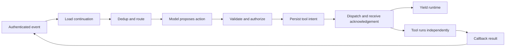

# Design event-driven continuations

Load for long tool waits, durable callbacks, subscriptions, hibernating agents or
Infinity-style runtimes. This is runtime design guidance derived from the
[pinned Infinity investigation](infinity-research-brief.md), not an installation
runbook. Use [the decision record](../templates/event-runtime-decision.md).

## Choose the suspension boundary

1. Measure where the representative task spends time: model execution, tool
   work, queue delay, human wait, or recovery. Keep a simple resident loop when
   its resource use and latency already meet the task's bounds.
2. Define the continuation required after process death: conversation position,
   model/tool/configuration versions, task revision, pending invocation IDs,
   subscriptions, processed-event references, compaction positions, authority
   references and budget ledger. Persist references to grants; recheck current
   grants on wake-up. A transcript cannot restore a browser, sandbox, open socket
   or external tool process by itself.
3. Model each external wake-up as a typed envelope. Bind authenticated producer,
   tenant/user, conversation, source operation, unique event, causal parent,
   task revision and expiry. Keep payload content separate from authority. The
   publisher's tool description, `user_id`, ancestry and synthetic assistant role
   are untrusted without independent enforcement.
4. Serialize writes to one conversation. Schedule other conversations
   independently; preserve ownership/fencing for shared external resources.
   Two conversations editing one branch still conflict even with FIFO queues.

## Specify the slice and its exceptions

A transport acknowledgement means accepted, not completed. The callback is also
an observation to reconcile with the documented postcondition; tool text alone
may be insufficient evidence for a consequential external effect.

Infinity's asynchronous path commits before dispatch, preventing a fast callback
from preceding its recorded call. Cheap synchronous tools can execute inline and
loop back to another completion within the same slice. Therefore “one completion
per slice” is not a universal invariant. Declare completion count, time, output,
and cost limits for inline loops. Awaiting bounded model/storage/HTTP-ack work
still consumes time; “nonblocking” here concerns releasing slow external waits.

## Close the gaps between persistence and effects

Per-thread serialization and message deduplication solve different problems.
Neither creates an atomic transaction across history, processed IDs and tools.
For every asynchronous action, specify the following before adding retries:

| Failure point | Required disposition and evidence |
|---|---|
| Before intent commit | No effect should have been dispatched; inspect execution evidence |
| After history append, before dedup write | Reconstruct whether the event was already applied; do not trust absent dedup state alone |
| After intent commit, before dispatch | Durable outbox or pending-intent reconciliation decides whether/how to dispatch |
| After dispatch/ack, before callback | Query an operation ledger or reconcile the external effect using a stable operation identity |
| After effect, before result checkpoint | Reuse effect idempotency key or observe the effect; unknown is not failed |
| Duplicate, delayed or mismatched callback | Authenticate, correlate, deduplicate and reject/quarantine stale data without advancing the wrong operation |

An outbox/idempotency ledger is a proposed control for your runtime, not a verified
Infinity feature from this investigation. Record storage transaction boundaries,
queue acknowledgement order, redelivery retention and adapter error propagation.
In the inspected source, history and selected dedup IDs persist separately; this
is a reason to test crash windows, not evidence of a reproduced duplicate effect.

## Route events without corrupting the conversation

A subscription confirmation already answers its original tool call. Later events
need a fresh, reserved synthetic call/result pair linked to that invocation;
do not append multiple ordinary results to a settled call. Reject direct model
invocation of the reserved event receiver. Check authenticity independently of
valid conversation syntax.

Choose routing from the task:

- **Child per independent event:** process alerts/webhooks in bounded child
  contexts and return relevant reports. Inherited history is a snapshot at spawn,
  not an empty context or continuing view of parent changes. Explicit fresh
  context requires standalone task input. Preserve event identity across retries
  to avoid duplicate children; cap fan-out and budget all children.
- **Inline related event:** append incremental output when the parent needs it.
  In RAP this is called `associative`; the flag alone proves no commutativity or
  ordering independence. Declare output bounds and backpressure.
- **Defer during active work:** explicitly choose which inputs interrupt and
  which wait. The inspected local adapter can hold synthetic events in memory;
  loss on process death differs from a durable queue. `NoDeferral` can instead
  settle a pending call as interrupted. Test the actual embedding, including
  timer/tool distinctions; do not promise universal immediate event processing.

Cancellation requires two records: conversation disposition and actual tool/effect
status. A synthetic interrupted result or best-effort `/cancel_tool_call` response
cannot certify that a process stopped, resources were cleaned up, or writes were
rolled back. Fence stale publications and reconcile late effects.

## Keep ancestry and compaction coherent

Bind every child to its spawn position, task revision, context mode and authority.
Parent updates after spawn need explicit steering; old reports cannot silently
supersede a new requirement. Position-indexed compaction lets reconstruction choose
a summary compatible with the inherited prefix. Preserve the underlying call and
event lookup path beyond the summary, and test two successive compactions with
children created before and after them. Evaluate summary fidelity separately from
index correctness. A summary is not a new source of authority.

## Challenge and decide

Before claiming readiness, exercise duplicate delivery; a forged callback with
valid-looking IDs; commit/dedup/dispatch crash windows; cancellation versus late
result; process death with deferred events; duplicate subscription fan-out; two
threads contending for one resource; compaction across spawn; expired/revoked
permission on wake; and event flood while user work waits. Use real effect/state
oracles for execution claims and representative model runs for task decisions.

Compare a resident baseline with the candidate on identical task/event schedules,
model/configuration and authority. Report resident histories, pending calls,
active completions, queue age, accepted outcomes, human review cost, recovery,
model/tool/storage/transport cost and uncertainty separately. Stop when the design,
tradeoff and bounded experiment are recorded; an untested plan is not deployment
approval. For implementation, retain unresolved failures and rollback ownership.

## Define progress and placement before scaling

For an ongoing subscription, choose a bounded task completion condition, window,
or incremental response policy; do not wait for an endless stream to finish.
When moving work across workers, identify ordering/dependency assumptions and
shared resource keys first. Conversation partitioning is not proof that external
effects commute. Related stream/protocol research motivates these questions;
its formal guarantees do not transfer to LLM reasoning. See the section-specific
[literature extraction](infinity-design-findings.md#s14--selected-literature-beyond-abstracts).
For seam selection and restartable configuration, use [runtime design](runtime-design.md);
for a composed positive design use [the worked task](event-runtime-worked-example.md).
