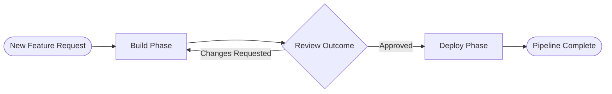

# Developer Pipeline Kanban — Decision Map

## Example: reject an incomplete implementation handoff

A planning stage can return one bounded slice with a governing artifact, its
accepted revision, the criterion and approved scope, open decisions and their
dependencies, required capabilities, and any evidence already gathered. For the
[export planning example](../../../../technical-project-management/references/flow-and-capacity.md#example-decisions-across-sessions),
send only the independent export-layout work. D-12 remains open and blocks the
former-member link behavior. Route that question to the recorded decision owner.

The receiving stage first verifies revision 4 is current, confirms the task
does not depend on D-12, and checks its authorized fixture/tool capabilities.
An unavailable capability produces a scoped hold with the missing prerequisite.
An updated brief requires revalidation of affected work. Send the implemented
slice to review with acceptance IDs and candidate-bound evidence. A runner
can carry this artifact between supported clients through their native
interfaces if both can verify the same contract. See the
[catalog return contracts](../../../../harness-engineering/references/catalog-composition.md)
for owner responsibilities.
